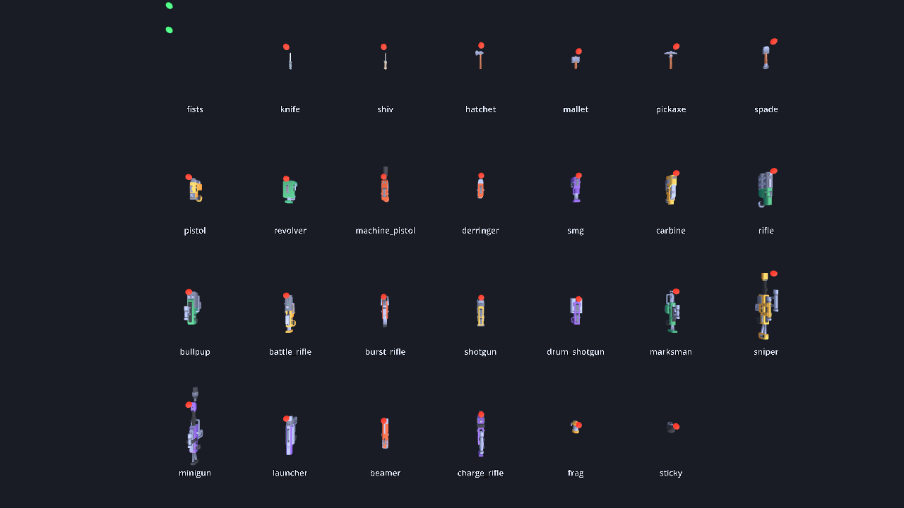

Twenty-seven ready-made weapons for [dot-weapon](https://github.com/modcommunity/dot-weapon) (blasters, melee weapons, grenades and fists), with everything a player sees and hears: first-person view models with arms, third-person world models, animation, tracers, sounds and recoil. Games in the [Dot collection](https://moddingcommunity.com/co/4-dot-assets), such as [game-fatal-contact](https://github.com/zees-games/game-fatal-contact), use it.

The pack has its own headless test suite, but little of it has been in front of real players. Please report anything you run into.



| Slot | Weapons |
| --- | --- |
| 1 Melee | Fists, Knife, Shiv, Hatchet, Mallet, Pickaxe, Spade |
| 2 Sidearm | Dart Pistol, Revolver, Machine Pistol, Derringer |
| 3 Primary | SMG, Carbine, Assault Rifle, Bullpup, Battle Rifle, Burst Rifle, Shotgun, Drum Shotgun, Marksman Rifle |
| 4 Heavy | Sniper Rifle, Minigun, Launcher, Beamer, Charge Rifle |
| 5 Thrown | Frag Grenade, Sticky Charge |

Every blaster can also bash with the alt-fire button. Weapons differ in how they play, not just in numbers: the knife is the fastest, the mallet hits hardest, the bullpup stays accurate while you move, the beamer rewards keeping aim on a target, and the minigun has no magazine. Seven ammunition types are shared between them.

## What it adds to dot-weapon

dot-weapon decides when a weapon fires, reloads and switches, but draws nothing. This pack is the part you see and hear.

| Class | What it does |
| --- | --- |
| `ZeeWeaponPack` | The twenty-seven weapons, tuned in ticks. A dedicated server can validate them at boot with no art installed. |
| `ZeeWeaponArtTable` | The only file that knows a filename. Weapons are named by role, so swapping art means editing this one table. |
| `ZeeViewModel` | The weapon in your own hands: gloved hands round the grip, sway, bob, recoil, draw and reload animations. `aim(held)` brings it up to the eye along an iron sight, and reports a zoom for the camera. The sniper, marksman rifle, bullpup and charge rifle use a scope overlay (`ZeeScopeOverlay`). Aiming is set per weapon in the art table. See [docs/view-model.md](docs/view-model.md). |
| `ZeeWorldModel` | The weapon in somebody else's hands. |
| `ZeeWeaponPose` | The animation maths, with no nodes, so tests can check it. |
| `ZeeShotFx` | Tracer, muzzle flash, impact effects and the shot sound. Never built on a server. |
| `ZeeWeaponSound` | A sound for each kind of weapon, generated on first use. The pack ships no audio files; `ZeeWeaponSound.set_stream(id, stream)` replaces any of them with a recording. |
| `ZeeWeaponNet` | Four small replicated fields on top of dot-weapon's, so other players see your gun fire and reload. |
| `ZeeWeaponRig` | The one node a game adds per player. It sets up everything above. |

## Using it

Copy `addons/zee_weapons/` and `assets/` into your project, next to `dot_core`, `dot_combat` and `dot_weapon`, and enable the plugin.

```gdscript
var rig := ZeeWeaponRig.new()
rig.role = ZeeWeaponRig.Role.LOCAL
rig.authority = true                       # false on a client that only predicts
rig.view_model_ref = DotNodeRef.of_path(view_model.get_path())
player.add_child(rig)
rig.setup()

rig.give(ZeeWeaponIds.RIFLE)
rig.give(ZeeWeaponIds.KNIFE)
```

Once per simulation tick:

```gdscript
var outcome := rig.simulate_tick(command, tick)

for shot in outcome.shots:
    combat.resolve(shot)                   # dot-combat, on the authority only
```

Once per rendered frame, for sway, bob and the camera's share of the recoil:

```gdscript
rig.drive_view(Vector2(yaw, pitch), speed, on_floor, crouched)

var punch := rig.view_punch()              # degrees: pitch up, and yaw
fps_view.external_angles = Vector3(punch.x, punch.y, 0.0)
```

Add the punch to the camera after your controller has positioned it. Do not add it to the command's angles: the shot has already gone where the command pointed.

Tracers, flashes, impacts and sounds come with the rig. Set `rig.effects = false` if your game draws its own from the `used` signal. The rig finds the player through `DotWeaponPlayerBridge`, which names no player or netcode class, so it works with dot-player or your own.

### Networking

```gdscript
# On the carrier's replicated object, once:
var specs := ZeeWeaponNet.all_specs()      # dot-weapon's three fields, plus this pack's four

# On the authority, every tick after simulating:
rig.pull_net(replicated)

# On a watcher, every snapshot:
_seen = ZeeWeaponNet.apply(replicated, world_model, _seen)["seq"]
```

A watcher's world model plays the flash, tracer and sound each time the shot counter moves. It stays quiet if the carrier's first-person rig is on the same machine. Ammunition is sent only to the weapon's owner; that a shot happened is sent to everybody.

### Rollback

`rig.snapshot()` and `rig.restore()` save and restore the arsenal, the bash cooldown, the charge and the previous command's buttons. Wrap a reconciliation replay in `rig.begin_replay()` and `rig.end_replay()` so nothing is drawn twice.

### Adding a second weapon pack

Another pack adds its weapons to this one, so every rig, world model and loot table in a game gets them with no change to the game:

```gdscript
ZeeWeaponPack.add_source(&"my_pack", Callable(MyPack, &"weapons"))
ZeeWeaponArtTable.add_source(&"my_pack", Callable(MyPack, &"art"))
ZeeWeaponSound.set_class(&"my_rifle", ZeeWeaponSound.RIFLE)
```

Pass static methods as above, not lambdas: a lambda kept by zee outlives its script and the game crashes at quit. An id this pack already has stays this pack's (the other is skipped with a warning). `remove_source(&"my_pack")` takes a pack out. [zed-dot-weapons](https://github.com/zees-games/zed-dot-weapons) does this.

## Requirements

Godot 4.7, plus [dot-core](https://github.com/modcommunity/dot-core), [dot-combat](https://github.com/modcommunity/dot-combat) and [dot-weapon](https://github.com/modcommunity/dot-weapon). dot-net, dot-player, dot-player-controller and dot-player-char are used if present. It runs on desktop, mobile and the browser from one build.

## Running it

The easiest way to get the pack and its addons is [dot-bootstrap](https://github.com/modcommunity/dot-bootstrap) (`./bootstrap.sh`, then `cd projects/zee-dot-weapons`).

| Command | What it does |
| --- | --- |
| `./game.sh` | A firing range you can walk around, holding every weapon |
| `./game.sh play -- --weapon smg --fire --capture /tmp/smg` | The range firing on its own, saving six frames from the first shot |
| `./game.sh test` | Check every script and run the test suite |
| `./game.sh shot --rack` | Every weapon at once, with a marker on each muzzle |
| `./game.sh help` | All options |

In the range: WASD to move, mouse to look, left click to fire, right click to bash, R to reload, 1 to 5 for slots, Q for the last weapon, the wheel to cycle, F1 to print the rig's state, N to cycle fire modes on guns that declare `fire_modes`.

## Credits

The twelve real-world guns are rebuilt by `blender -b --python art-src/guns/build.py` (one recipe per gun in `guns.py`). Parts are cut, reshaped and joined with modelled handguards, barrels, sights and magazines, so no gun is any one source model. Which parts each gun takes is in `assets/low-poly-guns/LICENSE.txt`. Each kit's licence is next to its files in `assets/`.

| Asset | Author / source | Licence |
| --- | --- | --- |
| Twelve real-world guns (parts) | [Quaternius](https://quaternius.com), [Ultimate Low Poly Guns Pack](https://opengameart.org/content/low-poly-guns-pack) | CC0 1.0 |
| Toy and sci-fi weapons, two gun parts | [Kenney](https://kenney.nl/assets/blaster-kit), Blaster Kit | CC0 1.0 |
| Melee weapons, ammunition | [Kenney](https://kenney.nl), Weapon Pack and Survival Kit | CC0 1.0 |
| Blocky arms (third style) | [Kenney](https://kenney.nl), Blocky Characters | CC0 1.0 |
| First-person arm (`assets/arms/arms-rigged.glb`) | para, [fps arms (rigged only)](https://opengameart.org/content/fps-arms-rigged-only), reshaped by `art-src/arms/build_arms.py`; changes in `assets/arms/LICENSE-fps-arms-para.txt` | CC0 1.0 |
| Fire-mode selector clicks | TMC: synthesised in `zee_weapon_sound.gd` | MIT |
| Code | TMC | MIT, see [LICENSE](LICENSE) |
