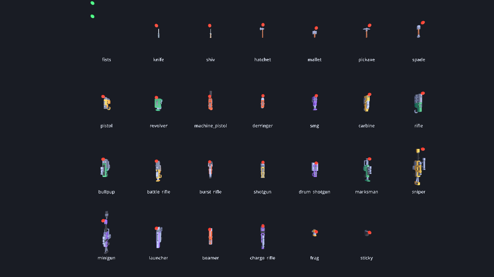

This is a weapons pack to demonstrate the capabilities of the [**Dot collection**](https://moddingcommunity.com/co/4-dot-assets) built on-top of [Godot 4](https://godotengine.org/) and [TMC's gaming platform](https://moddingcommunity.com/play). It adds twenty-seven ready-made weapons on top of [dot-weapon](https://github.com/modcommunity/dot-weapon) (blasters, melee weapons, grenades and fists), along with everything a player sees and hears: first-person view models with arms, third-person world models, animation, tracers, sounds and recoil. The games in the Dot collection, such as [game-arena](https://github.com/zees-games/game-arena), use it.

**This pack and the assets under it are COMPLETELY OPEN SOURCE**. You are free to use, modify, and distribute them under the terms of the MIT license, and the art it ships is CC0, which asks for even less. The only thing not open source is the back-end web infrastructure. So if you opt into using your own authentication backend instead of integrating with TMC, you will need to build and integrate your own back-end infrastructure.

## From Maintainer & WARNING
This pack, along with every asset it is built on, was built initially with **Claude Code** and will continue to be maintained and extended using it. This is because I (`gamemann`) cannot build the entire TMC platform alone (I wish I could lol).

**Please treat this as partially tested.** It has its own headless test suite and that suite passes, but very little of this has been in front of real players yet. Expect rough edges, and please report anything you run into.

I intend on reviewing code, testing, and editing documentation regularly. If you're interested in helping out, please let me know!

## What is in it
Art is Kenney's **Blaster Kit**, with the melee weapons from the Weapon Pack and Survival Kit. The first-person arms are a rigged arm mesh with finger bones, posed in code (two-bone IK to the grip, every finger wrapped to the grip's radius), reshaped from a CC0 base; without that file in a game the arms fall back to gloves built from boxes in code, and the Blocky Characters' arms are still there as a third style. All of it is CC0 and included, so there is nothing to download.



| Slot | Weapons |
| --- | --- |
| 1 · Melee | Fists, Knife, Shiv, Hatchet, Mallet, Pickaxe, Spade |
| 2 · Sidearm | Dart Pistol, Revolver, Machine Pistol, Derringer |
| 3 · Primary | SMG, Carbine, Assault Rifle, Bullpup, Battle Rifle, Burst Rifle, Shotgun, Drum Shotgun, Marksman Rifle |
| 4 · Heavy | Sniper Rifle, Minigun, Launcher, Beamer, Charge Rifle |
| 5 · Thrown | Frag Grenade, Sticky Charge |

Every blaster can also **bash** with the alt-fire button.

Each weapon plays differently, not just with different numbers. The knife is the fastest thing in the pack and the mallet hits hardest. The bullpup is the only weapon that stays accurate while you move. The beamer rewards keeping your aim on a target, not flicking to it, and the minigun has no magazine: it just runs out. The weapons share seven ammunition types between them, so picking up a box of darts is a real choice.

## What it adds to dot-weapon
dot-weapon decides when a weapon fires, reloads and switches, but it doesn't draw anything. This pack is the part you see and hear:

| Class | What it does |
| --- | --- |
| `ZeeWeaponPack` | The twenty-seven weapons, tuned in ticks and checked as one document. A dedicated server can validate them at boot without any art installed. |
| `ZeeWeaponArtTable` | The only file that knows a filename. Weapons are named by role, so swapping the art means editing this one table. |
| `ZeeViewModel` | The weapon in your own hands: gloved hands that close round the grip, magazine, attachments, sway, bob, recoil, a keyed draw and a reload that rolls the gun onto its side, and charge. It receives no world shadow and carries its own key light. `aim(held)` brings it up to the eye and looks down an iron sight measured from each gun's own model: a ring round a post at the front, centred on the crosshair, a notch at the rear, and the gun's top running down the screen below them. It reports a zoom for the camera (`aim_fov_scale()`). The sniper, marksman rifle, bullpup and charge rifle look through a scope instead (`ZeeScopeOverlay`). Aiming is set per weapon in the art table (`aim_enabled`, `aim_zoom`, `aim_scoped`, `iron_sight`, `aim_eye_relief`, `aim_time`) ; `ZeeAdsRules` adds the server-owned profile (see docs/view-model.md). |
| `ZeeWorldModel` | The weapon in somebody else's hands, attached to their character's hand. |
| `ZeeWeaponPose` | The animation maths, with no nodes in it, so the test suite can check the springs settle and nothing produces `NaN`. |
| `ZeeShotFx` | What a shot looks and sounds like: a tracer, a muzzle flash with a light, a spark and a puff where it lands, and the sound. Never built on a server. |
| `ZeeWeaponSound` | A sound for each kind of weapon (light, magnum, rifle, heavy, sniper, shotgun, minigun, launcher, beam, charge, plus swings, bashes, throws, impacts and reloads), generated on first use. The pack ships no audio files; `ZeeWeaponSound.set_stream(id, stream)` replaces any of them with a real recording. |
| `ZeeWeaponNet` | Four small replicated fields on top of dot-weapon's, so other players see your gun fire and reload. |
| `ZeeWeaponRig` | The one node a game adds per player. It sets up everything above in the right order. |

## Using it
Copy `addons/zee_weapons/` and `assets/` into your project, next to `dot_core`, `dot_combat` and `dot_weapon`, and enable the plugin.

```gdscript
var rig := ZeeWeaponRig.new()
rig.role = ZeeWeaponRig.Role.LOCAL
rig.authority = true                       # false on a client that only predicts
rig.view_model_ref = DotNodeRef.of_path(view_model.get_path())
player.add_child(rig)
rig.setup()

rig.give(ZeeWeaponIds.RIFLE)
rig.give(ZeeWeaponIds.KNIFE)
```

Once per simulation tick:

```gdscript
var outcome := rig.simulate_tick(command, tick)

for shot in outcome.shots:
    combat.resolve(shot)                   # dot-combat, on the authority only
```

Once per rendered frame, for sway, bob and the camera's share of the recoil:

```gdscript
rig.drive_view(Vector2(yaw, pitch), speed, on_floor, crouched)

var punch := rig.view_punch()              # degrees: pitch up, and yaw
fps_view.external_angles = Vector3(punch.x, punch.y, 0.0)
```

Add the punch to the camera after your controller has positioned it. Don't add it to the command's angles: the shot has already gone where the command pointed.

Tracers, flashes, impacts and sounds come with the rig. Set `rig.effects = false` if your game draws its own from the `used` signal; `rig.shot_fx()` returns the node, for its audio bus and volume.

That's the whole integration. The rig finds the player through `DotWeaponPlayerBridge`, which doesn't name any player, controller or netcode class, so it works with dot-player or with your own.

### Networking

```gdscript
# On the carrier's replicated object, once:
var specs := ZeeWeaponNet.all_specs()      # dot-weapon's three fields, plus this pack's four

# On the authority, every tick after simulating:
rig.pull_net(replicated)

# On a watcher, every snapshot:
_seen = ZeeWeaponNet.apply(replicated, world_model, _seen)["seq"]
```

A watcher's world model plays the flash, a tracer and the sound each time the shot counter moves. It stays quiet if the carrier's first-person rig is on the same machine, so your own shots aren't heard twice.

Ammunition is only sent to the weapon's owner, since exact magazine counts would help an opponent. That a shot happened is sent to everybody.

### Rollback
`rig.snapshot()` and `rig.restore()` save and restore the arsenal, the bash cooldown, the charge and the previous command's buttons. Wrap a reconciliation replay in `rig.begin_replay()` / `rig.end_replay()` so the simulation runs again without drawing anything twice.

### Adding a second weapon pack
Another pack adds its weapons to this one instead of replacing it, so every rig, world model and loot table in a game gets them with no change to the game:

```gdscript
ZeeWeaponPack.add_source(&"my_pack", Callable(MyPack, &"weapons"))
ZeeWeaponArtTable.add_source(&"my_pack", Callable(MyPack, &"art"))
ZeeWeaponSound.set_class(&"my_rifle", ZeeWeaponSound.RIFLE)
```

Pass static methods as above, not lambdas: a lambda kept by zee outlives its script and the game crashes as it quits. An id this pack already has stays this pack's (the other one is skipped, with a warning). `remove_source(&"my_pack")` takes them out again. [zed-dot-weapons](https://github.com/zees-games/zed-dot-weapons) is a pack that does this.

## Requirements
Godot **4.7**, plus three addons: [dot-core](https://github.com/modcommunity/dot-core), [dot-combat](https://github.com/modcommunity/dot-combat) and [dot-weapon](https://github.com/modcommunity/dot-weapon). dot-net, dot-player, dot-player-controller and dot-player-char are optional and are used if present.

It works on desktop, mobile and in the browser from one build. Nothing in it opens a socket, reads a clock, starts a thread or writes to `user://`.

## Running it
The easiest way to get the pack and its addons is [dot-bootstrap](https://github.com/modcommunity/dot-bootstrap) (`./bootstrap.sh`, then `cd projects/zee-dot-weapons`). Then:

| Command | What it does |
| --- | --- |
| `./game.sh` | A firing range you can walk around, holding any of the twenty-seven |
| `./game.sh play -- --weapon smg --fire --capture /tmp/smg` | The range firing on its own, saving six frames from the first shot |
| `./game.sh test` | Check every script and run the test suite |
| `./game.sh shot --rack` | Every weapon at once, with a marker on each muzzle |
| `./game.sh help` | All of the options |

In the range: **WASD** to move, mouse to look, **left click** to fire, **right click** to bash, **R** to reload, **1**-**5** for the slots, **Q** for the last weapon, the wheel to cycle, and **F1** to print the rig's state.

## Credits
The twelve real-world guns are kitbashed by the Blender scripts in `art-src/guns/` (one recipe per gun in `guns.py`): parts of [Quaternius](https://quaternius.com)'s [Ultimate Low Poly Guns Pack](https://opengameart.org/content/low-poly-guns-pack) (CC0) and two parts of Kenney's [Blaster Kit](https://kenney.nl/assets/blaster-kit) (CC0) are cut, reshaped and joined with handguards, barrels, muzzle devices, sights, rails, magazines and tubes modelled in the script, then recoloured to the pack's own palette and bevelled, so no gun is any one source model. Which parts each gun takes, and what was changed, is in `assets/low-poly-guns/LICENSE.txt`; `blender -b --python art-src/guns/build.py` rebuilds them. The toy and sci-fi weapons and everything else are by [Kenney](https://kenney.nl) (CC0): the [Blaster Kit](https://kenney.nl/assets/blaster-kit), the Weapon Pack, the Survival Kit and the Blocky Characters. The first-person arm (`assets/arms/arms-rigged.glb`) is built by `art-src/arms/build_arms.py` from [para](https://opengameart.org)'s [fps arms (rigged only)](https://opengameart.org/content/fps-arms-rigged-only) (CC0, built with MakeHuman): one arm kept, the author's control bones and skin texture dropped, the mesh split into glove and sleeve surfaces with a flared cuff and a fuller sleeve, and rescaled; what was changed is in `assets/arms/LICENSE-fps-arms-para.txt`, and `art-src/arms/render_arms.py` renders its contact sheet. Only the files the pack uses are included, each kit's licence next to its files in `assets/`.

The fire-mode selector clicks (`mode_click_light`, `mode_click_rifle`, `mode_click_heavy`) are original synthesis in `zee_weapon_sound.gd`, no external recording, so they carry the pack's MIT licence. N cycles semi, burst and auto on every gun that declares `fire_modes`; a recording can replace any of them through `ZeeWeaponSound`.

## License
MIT. See [LICENSE](LICENSE). The Kenney art is CC0, which is public domain.
