# Zee Weapons

Twenty-seven low-poly weapons for GameSpice games, in a bright toy-blaster style: seven melee weapons, four sidearms, nine primaries, five heavies and two grenades. Each one has a first-person view model with arms, a world model, sounds and a tuned profile, and every number below is a default read straight from the pack's data that a game or server can change without touching the pack.

### In GameSpice and Fatal Contact

- **GameSpice:** the pack is published to the Workshop as `gamemann/zee-dot-weapons`. Playlot needs it, and a server lists it in its pack overlay, so players get it with the game or the server and there is nothing to install. Its weapons appear in the spawn menu under Melee, Sidearms, Primary, Heavy and Thrown.
- **Fatal Contact:** FC's own weapons are [fc-weapons](https://github.com/zees-games/fc-weapons). An FC server can add this pack to its overlay for extra weapons, and [zed-dot-weapons](https://github.com/zees-games/zed-dot-weapons) builds on it.
- **Your own Godot game:** link or copy `addons/zee_weapons/` and `assets/` beside dot-weapon and use the code in [Using it](#using-it). Server owners retune any weapon in `cfg/addons/zee_weapons/weapon/<id>.yml`.

The weapons plug into [dot-weapon](https://github.com/gamespice-platform/weapon) (blasters, melee weapons, grenades and fists), with everything a player sees and hears: first-person view models with arms, third-person world models, animation, tracers, sounds and recoil. Games in the [GameSpice collection](https://gamespice.net), such as Playlot and [Fatal Contact](https://github.com/zees-games/game-fatal-contact) servers, use it.

The pack has its own headless test suite, but little of it has been in front of real players. Please report anything you run into.


| Slot | Weapons |
| --- | --- |
| 1 Melee | Fists, Knife, Shiv, Hatchet, Mallet, Pickaxe, Spade |
| 2 Sidearm | Dart Pistol, Revolver, Machine Pistol, Derringer |
| 3 Primary | SMG, Carbine, Assault Rifle, Bullpup, Battle Rifle, Burst Rifle, Shotgun, Drum Shotgun, Marksman Rifle |
| 4 Heavy | Sniper Rifle, Minigun, Launcher, Beamer, Charge Rifle |
| 5 Thrown | Frag Grenade, Sticky Charge |

Every blaster can also bash with the alt-fire button. Weapons differ in how they play, not just in numbers: the knife is the fastest, the mallet hits hardest, the bullpup stays accurate while you move, the beamer rewards keeping aim on a target, and the minigun has no magazine. Seven ammunition types are shared between them.

<!-- gen_readme:summary -->
| | Weapon | Class | Damage | Rate |
| --- | --- | --- | --- | --- |
|  | [Fists](#fists) | Melee | 22 | 120 rpm |
| <a href="#knife"></a> | [Knife](#knife) | Melee | 45 | 148 rpm |
| <a href="#shiv">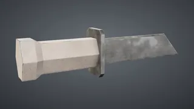</a> | [Shiv](#shiv) | Melee | 34 | 192 rpm |
| <a href="#hatchet">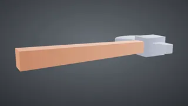</a> | [Hatchet](#hatchet) | Melee | 62 | 80 rpm |
| <a href="#mallet">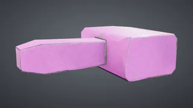</a> | [Mallet](#mallet) | Melee | 85 | 55 rpm |
| <a href="#pickaxe">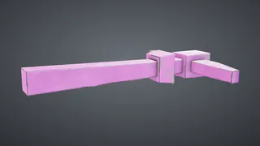</a> | [Pickaxe](#pickaxe) | Melee | 68 | 70 rpm |
| <a href="#spade">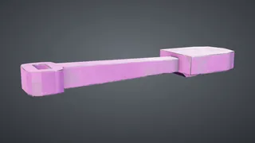</a> | [Spade](#spade) | Melee | 56 | 85 rpm |
| <a href="#dart-pistol"></a> | [Dart Pistol](#dart-pistol) | Pistol | 20 | 384 rpm |
| <a href="#revolver">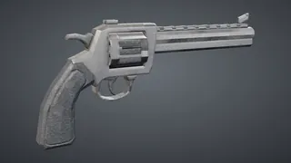</a> | [Revolver](#revolver) | Pistol | 46 | 142 rpm |
| <a href="#machine-pistol">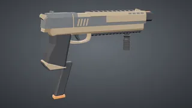</a> | [Machine Pistol](#machine-pistol) | Pistol | 13 | 960 rpm |
| <a href="#derringer">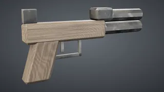</a> | [Derringer](#derringer) | Pistol | 62 | 89 rpm |
| <a href="#smg">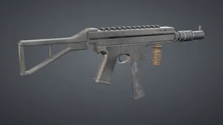</a> | [SMG](#smg) | SMG | 16 | 768 rpm |
| <a href="#carbine"></a> | [Carbine](#carbine) | Assault rifle | 21 | 640 rpm |
| <a href="#assault-rifle">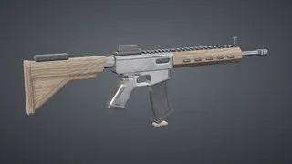</a> | [Assault Rifle](#assault-rifle) | Assault rifle | 23 | 640 rpm |
| <a href="#bullpup">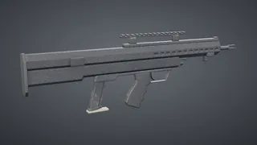</a> | [Bullpup](#bullpup) | Assault rifle | 20 | 768 rpm |
| <a href="#battle-rifle">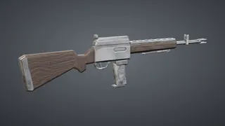</a> | [Battle Rifle](#battle-rifle) | Battle rifle | 36 | 295 rpm |
| <a href="#burst-rifle">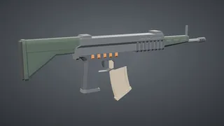</a> | [Burst Rifle](#burst-rifle) | Assault rifle | 24 | 240 rpm |
| <a href="#shotgun">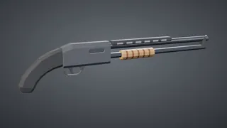</a> | [Shotgun](#shotgun) | Shotgun | 12 x 9 | 75 rpm |
| <a href="#drum-shotgun">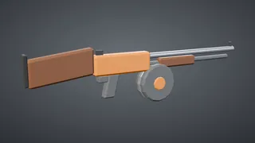</a> | [Drum Shotgun](#drum-shotgun) | Shotgun | 8 x 7 | 192 rpm |
| <a href="#marksman-rifle">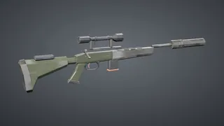</a> | [Marksman Rifle](#marksman-rifle) | Marksman rifle | 58 | 183 rpm |
| <a href="#sniper-rifle">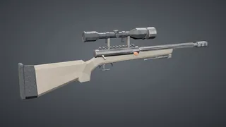</a> | [Sniper Rifle](#sniper-rifle) | Sniper rifle | 118 | 45 rpm |
| <a href="#minigun">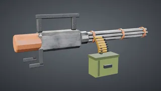</a> | [Minigun](#minigun) | Heavy | 11 | 1280 rpm |
| <a href="#launcher">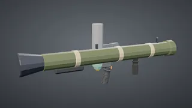</a> | [Launcher](#launcher) | Launcher | 32 | 70 rpm |
| <a href="#beamer">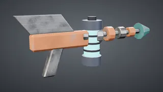</a> | [Beamer](#beamer) | Energy | 9 | 960 rpm |
| <a href="#charge-rifle">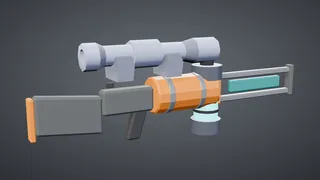</a> | [Charge Rifle](#charge-rifle) | Energy | 105 | 89 rpm |
| <a href="#frag-grenade">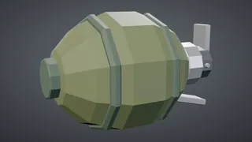</a> | [Frag Grenade](#frag-grenade) | Grenade | 115 splash | 60 rpm |
| <a href="#sticky-charge">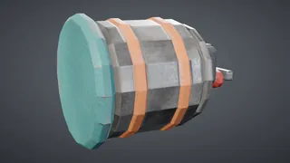</a> | [Sticky Charge](#sticky-charge) | Grenade | 135 splash | 60 rpm |
<!-- /gen_readme:summary -->

## What it adds to dot-weapon

dot-weapon decides when a weapon fires, reloads and switches, but draws nothing. This pack is the part you see and hear.

| Class | What it does |
| --- | --- |
| `ZeeWeaponPack` | The twenty-seven weapons, tuned in ticks. A dedicated server can validate them at boot with no art installed. |
| `ZeeWeaponArtTable` | The only file that knows a filename. Weapons are named by role, so swapping art means editing this one table. |
| `ZeeViewModel` | The weapon in your own hands: gloved hands round the grip, sway, bob, recoil, draw and reload animations. `aim(held)` brings it up to the eye along an iron sight, and reports a zoom for the camera. The sniper, marksman rifle, bullpup and charge rifle use a scope overlay (`ZeeScopeOverlay`). Aiming is set per weapon in the art table. See [docs/view-model.md](docs/view-model.md). |
| `ZeeWorldModel` | The weapon in somebody else's hands. |
| `ZeeWeaponPose` | The animation maths, with no nodes, so tests can check it. |
| `ZeeShotFx` | Tracer, muzzle flash, impact effects and the shot sound. Never built on a server. |
| `ZeeWeaponSound` | A sound for each kind of weapon, generated on first use. The pack ships no audio files; `ZeeWeaponSound.set_stream(id, stream)` replaces any of them with a recording. |
| `ZeeWeaponNet` | Four small replicated fields on top of dot-weapon's, so other players see your gun fire and reload. |
| `ZeeWeaponRig` | The one node a game adds per player. It sets up everything above. |

## Using it

Copy `addons/zee_weapons/` and `assets/` into your project, next to `dot_core`, `dot_combat` and `dot_weapon`, and enable the plugin.

```gdscript
var rig := ZeeWeaponRig.new()
rig.role = ZeeWeaponRig.Role.LOCAL
rig.authority = true                       # false on a client that only predicts
rig.view_model_ref = DotNodeRef.of_path(view_model.get_path())
player.add_child(rig)
rig.setup()

rig.give(ZeeWeaponIds.RIFLE)
rig.give(ZeeWeaponIds.KNIFE)
```

Once per simulation tick:

```gdscript
var outcome := rig.simulate_tick(command, tick)

for shot in outcome.shots:
    combat.resolve(shot)                   # dot-combat, on the authority only
```

Once per rendered frame, for sway, bob and the camera's share of the recoil:

```gdscript
rig.drive_view(Vector2(yaw, pitch), speed, on_floor, crouched)

var punch := rig.view_punch()              # degrees: pitch up, and yaw
fps_view.external_angles = Vector3(punch.x, punch.y, 0.0)
```

Add the punch to the camera after your controller has positioned it. Do not add it to the command's angles: the shot has already gone where the command pointed.

Tracers, flashes, impacts and sounds come with the rig. Set `rig.effects = false` if your game draws its own from the `used` signal. The rig finds the player through `DotWeaponPlayerBridge`, which names no player or netcode class, so it works with dot-player or your own.

### Networking

```gdscript
# On the carrier's replicated object, once:
var specs := ZeeWeaponNet.all_specs()      # dot-weapon's three fields, plus this pack's four

# On the authority, every tick after simulating:
rig.pull_net(replicated)

# On a watcher, every snapshot:
_seen = ZeeWeaponNet.apply(replicated, world_model, _seen)["seq"]
```

A watcher's world model plays the flash, tracer and sound each time the shot counter moves. It stays quiet if the carrier's first-person rig is on the same machine. Ammunition is sent only to the weapon's owner; that a shot happened is sent to everybody.

### Rollback

`rig.snapshot()` and `rig.restore()` save and restore the arsenal, the bash cooldown, the charge and the previous command's buttons. Wrap a reconciliation replay in `rig.begin_replay()` and `rig.end_replay()` so nothing is drawn twice.

### Adding a second weapon pack

Another pack adds its weapons to this one, so every rig, world model and loot table in a game gets them with no change to the game:

```gdscript
ZeeWeaponPack.add_source(&"my_pack", Callable(MyPack, &"weapons"))
ZeeWeaponArtTable.add_source(&"my_pack", Callable(MyPack, &"art"))
ZeeWeaponSound.set_class(&"my_rifle", ZeeWeaponSound.RIFLE)
```

Pass static methods as above, not lambdas: a lambda kept by zee outlives its script and the game crashes at quit. An id this pack already has stays this pack's (the other is skipped with a warning). `remove_source(&"my_pack")` takes a pack out. [zed-dot-weapons](https://github.com/zees-games/zed-dot-weapons) does this.

## Requirements

Godot 4.7, plus [dot-core](https://github.com/gamespice-platform/core), [dot-combat](https://github.com/gamespice-platform/combat) and [dot-weapon](https://github.com/gamespice-platform/weapon). dot-net, dot-player, dot-player-controller and dot-player-char are used if present. It runs on desktop, mobile and the browser from one build.

## Running it

The easiest way to get the pack and its addons is [dot-bootstrap](https://github.com/gamespice-platform/bootstrap) (`./bootstrap.sh`, then `cd projects/zee-dot-weapons`).

| Command | What it does |
| --- | --- |
| `./game.sh` | A firing range you can walk around, holding every weapon |
| `./game.sh play -- --weapon smg --fire --capture /tmp/smg` | The range firing on its own, saving six frames from the first shot |
| `./game.sh test` | Check every script and run the test suite |
| `./game.sh shot --rack` | Every weapon at once, with a marker on each muzzle |
| `./game.sh help` | All options |

In the range: WASD to move, mouse to look, left click to fire, right click to bash, R to reload, 1 to 5 for slots, Q for the last weapon, the wheel to cycle, F1 to print the rig's state, N to cycle fire modes on guns that declare `fire_modes`.

<!-- gen_readme:weapons -->
## The weapons

### Fists

**Melee** `fists`. Bare hands, for when everything else is empty or dropped. Weak, but you always have them.

| Default | |
| --- | --- |
| Damage | 22 (strike) |
| Swing rate | 120 rpm |
| Fire modes | semi |
| Reach | 1.6 m |
| Swing arc | 30 deg |
| Draw time | 0.25 s |
| Weight | 1.5 kg |

### Knife

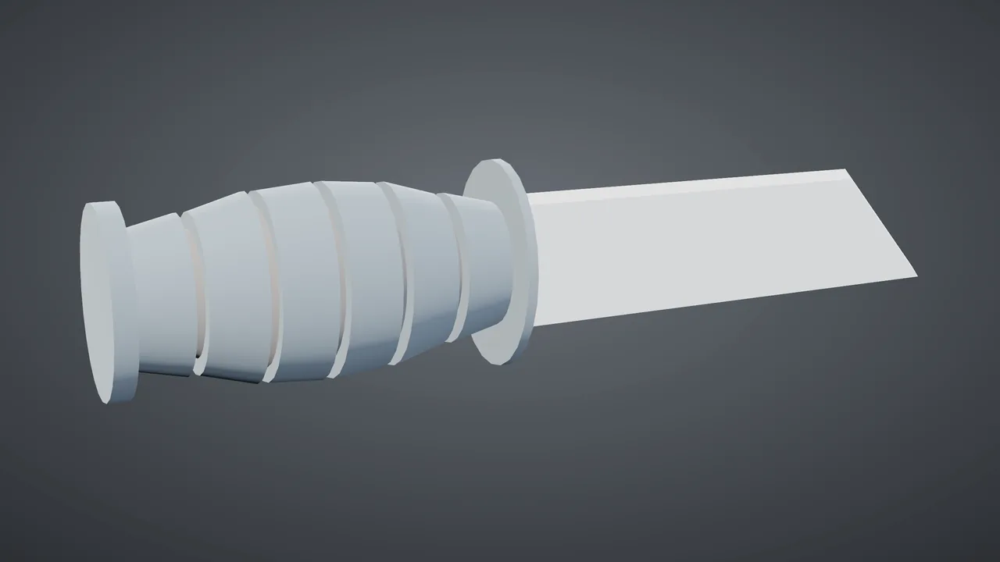

**Melee** `knife`. The all-round blade. Quick to draw and quick to swing, with more bite than the shiv for a short reach.

| Default | |
| --- | --- |
| Damage | 45 (strike) |
| Swing rate | 148 rpm |
| Fire modes | semi |
| Reach | 1.9 m |
| Swing arc | 24 deg |
| Draw time | 0.16 s |
| Weight | 0.4 kg |

### Shiv

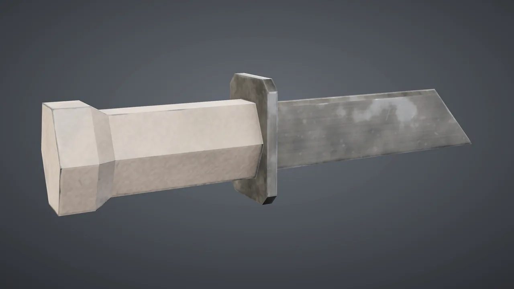

**Melee** `shiv`. A shorter, lighter blade. The quickest swing and draw of anything here, traded for less damage per hit.

| Default | |
| --- | --- |
| Damage | 34 (strike) |
| Swing rate | 192 rpm |
| Fire modes | semi |
| Reach | 1.8 m |
| Swing arc | 20 deg |
| Draw time | 0.12 s |
| Weight | 1.5 kg |

### Hatchet

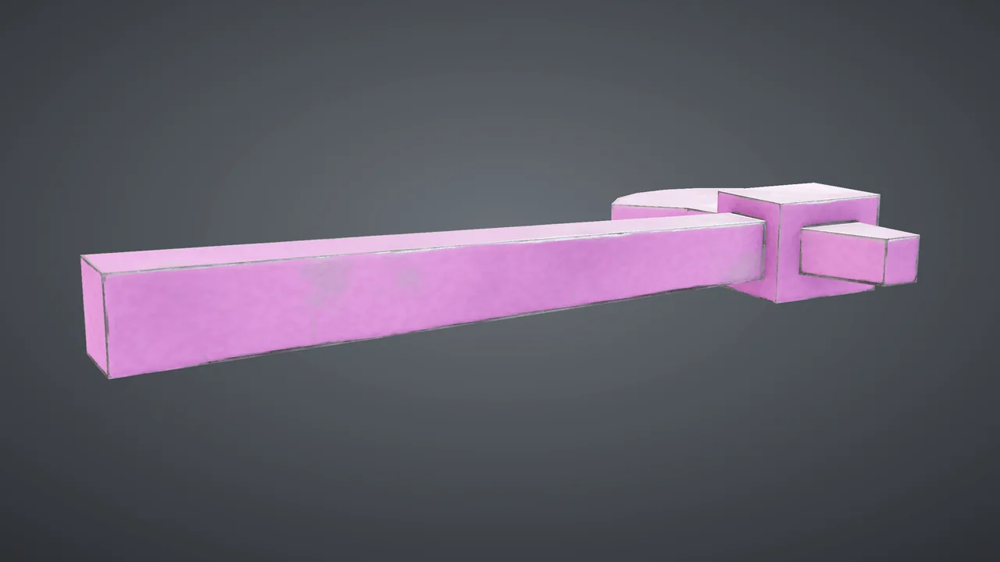

**Melee** `hatchet`. A slower chop that lands hard. Two hits finish most fights at close range.

| Default | |
| --- | --- |
| Damage | 62 (strike) |
| Swing rate | 80 rpm |
| Fire modes | semi |
| Reach | 2 m |
| Swing arc | 40 deg |
| Draw time | 0.25 s |
| Weight | 1.5 kg |

### Mallet


**Melee** `mallet`. The heaviest hit in the melee slot. Slow to draw and slow to swing, with a wide arc that is hard to dodge.

| Default | |
| --- | --- |
| Damage | 85 (strike) |
| Swing rate | 55 rpm |
| Fire modes | semi |
| Reach | 1.9 m |
| Swing arc | 50 deg |
| Draw time | 0.5 s |
| Weight | 1.5 kg |

### Pickaxe


**Melee** `pickaxe`. The longest reach of the melee weapons, with a narrow arc. It rewards a precise swing from just out of range.

| Default | |
| --- | --- |
| Damage | 68 (strike) |
| Swing rate | 70 rpm |
| Fire modes | semi |
| Reach | 2.4 m |
| Swing arc | 26 deg |
| Draw time | 0.25 s |
| Weight | 1.5 kg |

### Spade


**Melee** `spade`. A wide, sweeping swing with good reach. Forgiving to aim when the target is moving.

| Default | |
| --- | --- |
| Damage | 56 (strike) |
| Swing rate | 85 rpm |
| Fire modes | semi |
| Reach | 2.3 m |
| Swing arc | 55 deg |
| Draw time | 0.25 s |
| Weight | 1.5 kg |

### Dart Pistol

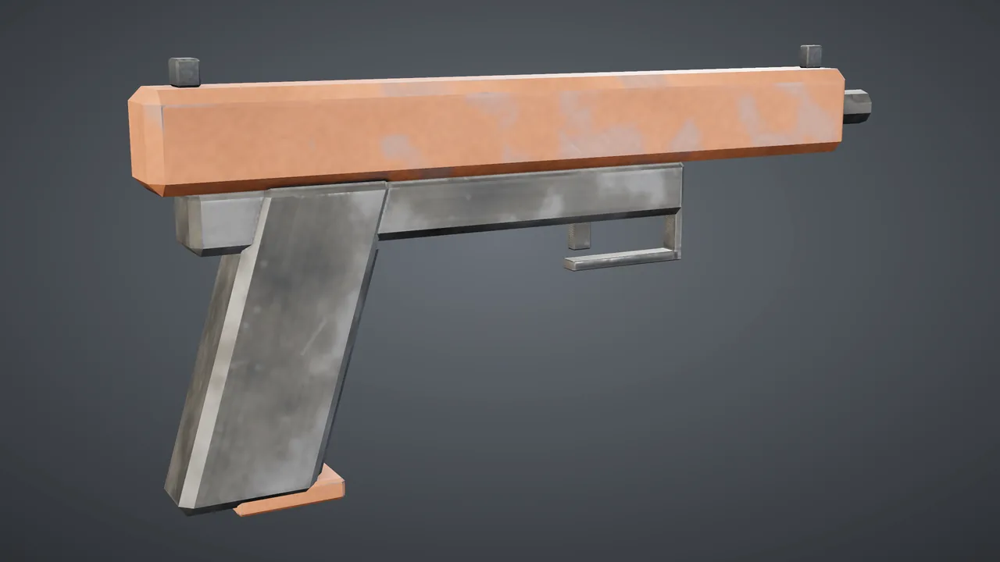

**Pistol** `pistol`. The dependable sidearm. Accurate, quick to draw and fast to reload, with enough darts to finish what the main gun started.

| Default | |
| --- | --- |
| Damage | 20 (dart) |
| Fire rate | 384 rpm |
| Fire modes | semi |
| Magazine | 15 + 60 reserve |
| Reload | 1.59 s |
| Spread | 0.35 deg standing, 1.5 moving, 0.5 crouched, 4 airborne |
| Bloom | +0.3 deg per shot, up to 2.6 |
| Recoil | 0.5 deg up, 0.15 deg side |
| Range | 120 m (falloff 30-70 m to 60 %) |
| Draw time | 0.22 s |
| Weight | 1 kg |

### Revolver

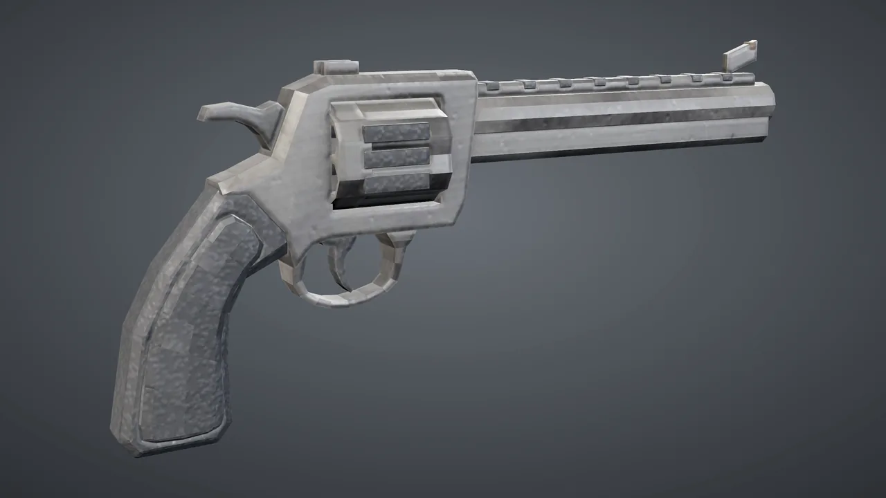

**Pistol** `revolver`. Six heavy rounds and a stiff kick. Accurate from standing, but the bloom after each shot punishes rushing.

| Default | |
| --- | --- |
| Damage | 46 (dart) |
| Fire rate | 142 rpm |
| Fire modes | semi |
| Magazine | 6 + 36 reserve |
| Reload | 2.41 s |
| Spread | 0.2 deg standing, 2.4 moving, 0.5 crouched, 4 airborne |
| Bloom | +1.1 deg per shot, up to 5 |
| Recoil | 2.4 deg up, 0.5 deg side |
| Range | 100 m (falloff 30-70 m to 60 %) |
| Draw time | 0.3 s |
| Weight | 1 kg |

### Machine Pistol

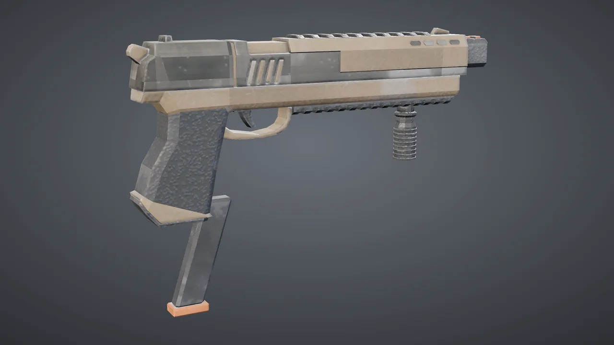

**Pistol** `machine_pistol`. A pocket bullet hose that empties its magazine in under two seconds, with burst and semi for when spraying is not the answer.

| Default | |
| --- | --- |
| Damage | 13 (dart) |
| Fire rate | 960 rpm |
| Fire modes | auto, semi, burst |
| Burst | 3 rounds |
| Magazine | 25 + 100 reserve |
| Reload | 1.91 s |
| Spread | 0.9 deg standing, 3.2 moving, 0.5 crouched, 6 airborne |
| Bloom | +0.32 deg per shot, up to 5.5 |
| Recoil | 0.3 deg up, 0.18 deg side |
| Range | 70 m (falloff 30-70 m to 60 %) |
| Draw time | 0.25 s |
| Weight | 1 kg |

### Derringer

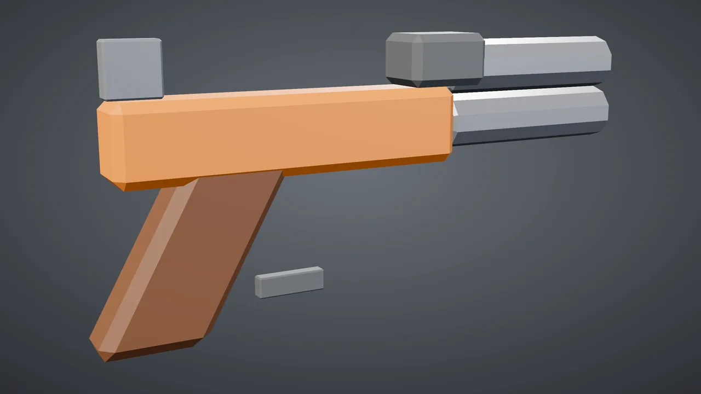

**Pistol** `derringer`. Two barrels, two shots, big damage at arm's length. A last-ditch backup that wins a corner fight and little else.

| Default | |
| --- | --- |
| Damage | 62 (dart) |
| Fire rate | 89 rpm |
| Fire modes | semi |
| Magazine | 2 + 12 reserve |
| Reload | 2 s |
| Spread | 2.2 deg standing, 5 moving, 0.5 crouched, 4 airborne |
| Recoil | 3.2 deg up, 0.15 deg side |
| Range | 18 m |
| Draw time | 0.19 s |
| Weight | 1 kg |

### SMG

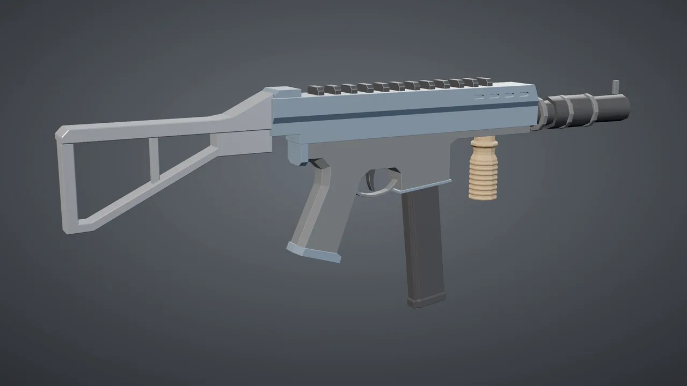

**SMG** `smg`. Light, fast and steady on the move. The pick for clearing rooms and running between them.

| Default | |
| --- | --- |
| Damage | 16 (dart) |
| Fire rate | 768 rpm |
| Fire modes | auto, semi, burst |
| Burst | 3 rounds |
| Magazine | 30 + 120 reserve |
| Reload | 1.8 s |
| Spread | 0.7 deg standing, 2.4 moving, 0.6 crouched, 5 airborne |
| Bloom | +0.26 deg per shot, up to 4.5 |
| Recoil | 0.26 deg up, 0.14 deg side |
| Range | 80 m (falloff 30-70 m to 60 %) |
| Draw time | 0.27 s |
| Weight | 2.8 kg |

### Carbine

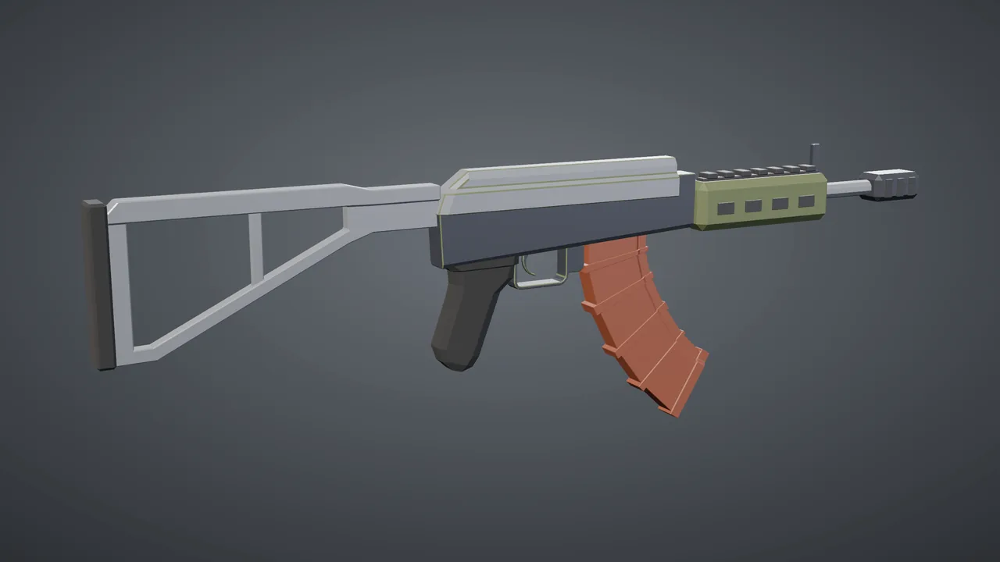

**Assault rifle** `carbine`. A short, light rifle. A little less damage and range than the assault rifle for a quicker handling all-rounder.

| Default | |
| --- | --- |
| Damage | 21 (dart) |
| Fire rate | 640 rpm |
| Fire modes | auto, semi, burst |
| Burst | 3 rounds |
| Magazine | 24 + 96 reserve |
| Reload | 2 s |
| Spread | 0.5 deg standing, 2.1 moving, 0.55 crouched, 4.5 airborne |
| Bloom | +0.28 deg per shot, up to 4.2 |
| Recoil | 0.34 deg up, 0.14 deg side |
| Range | 140 m (falloff 30-70 m to 60 %) |
| Draw time | 0.3 s |
| Weight | 4 kg |

### Assault Rifle

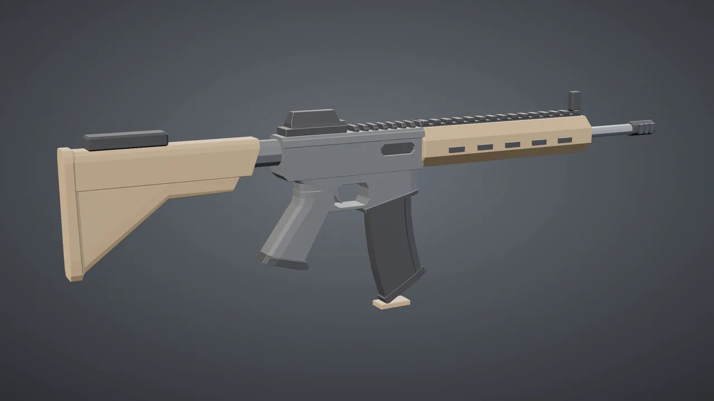

**Assault rifle** `rifle`. The all-rounder. Full auto with a burst option, accurate at mid range and controllable in long sprays.

| Default | |
| --- | --- |
| Damage | 23 (dart) |
| Fire rate | 640 rpm |
| Fire modes | auto, semi, burst |
| Burst | 3 rounds |
| Magazine | 30 + 120 reserve |
| Reload | 2.2 s |
| Spread | 0.45 deg standing, 2.2 moving, 0.5 crouched, 4.8 airborne |
| Bloom | +0.27 deg per shot, up to 4.6 |
| Recoil | 0.36 deg up, 0.15 deg side |
| Range | 180 m (falloff 30-70 m to 60 %) |
| Draw time | 0.31 s |

### Bullpup

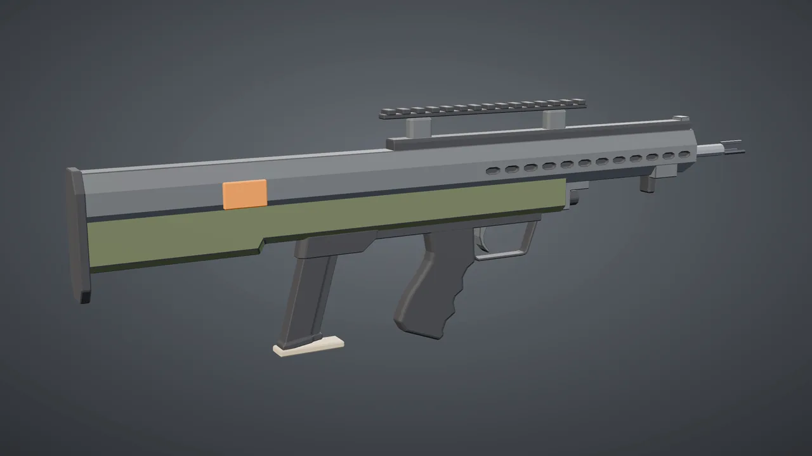

**Assault rifle** `bullpup`. A fast-firing rifle with a scope that stays accurate while you move.

| Default | |
| --- | --- |
| Damage | 20 (dart) |
| Fire rate | 768 rpm |
| Fire modes | auto, semi, burst |
| Burst | 3 rounds |
| Magazine | 32 + 128 reserve |
| Reload | 2.41 s |
| Spread | 0.5 deg standing, 1 moving, 3.4 airborne |
| Bloom | +0.3 deg per shot, up to 4 |
| Recoil | 0.32 deg up, 0.2 deg side |
| Range | 150 m (falloff 30-70 m to 60 %) |
| Draw time | 0.34 s |
| Weight | 5 kg |

### Battle Rifle

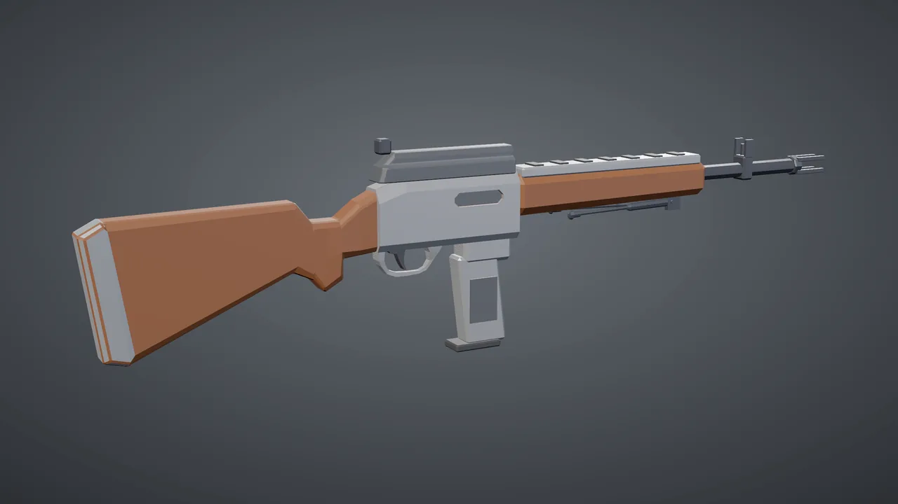

**Battle rifle** `battle_rifle`. Semi-automatic and hard-hitting at long range. Bloom climbs quickly, so pace your shots.

| Default | |
| --- | --- |
| Damage | 36 (dart) |
| Fire rate | 295 rpm |
| Fire modes | semi |
| Magazine | 20 + 80 reserve |
| Reload | 2.3 s |
| Spread | 0.25 deg standing, 2.6 moving, 0.4 crouched, 4 airborne |
| Bloom | +0.7 deg per shot, up to 4 |
| Recoil | 1.1 deg up, 0.2 deg side |
| Range | 200 m (falloff 30-70 m to 60 %) |
| Draw time | 0.36 s |
| Weight | 4 kg |

### Burst Rifle

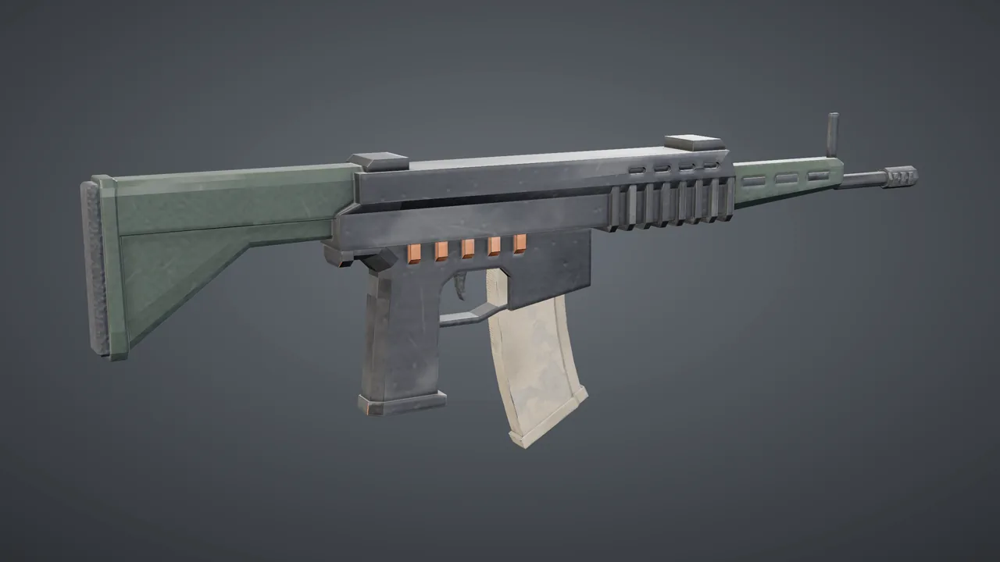

**Assault rifle** `burst_rifle`. Three-round bursts with very little recoil. Land a whole burst and the target is nearly gone.

| Default | |
| --- | --- |
| Damage | 24 (dart) |
| Fire rate | 240 rpm |
| Fire modes | burst, semi, auto |
| Burst | 3 rounds |
| Magazine | 30 + 90 reserve |
| Reload | 2.09 s |
| Spread | 0.3 deg standing, 1.8 moving, 0.5 crouched, 4 airborne |
| Bloom | +0.2 deg per shot, up to 2 |
| Recoil | 0.55 deg up, 0.12 deg side |
| Range | 160 m (falloff 30-70 m to 60 %) |
| Draw time | 0.3 s |
| Weight | 4 kg |

### Shotgun

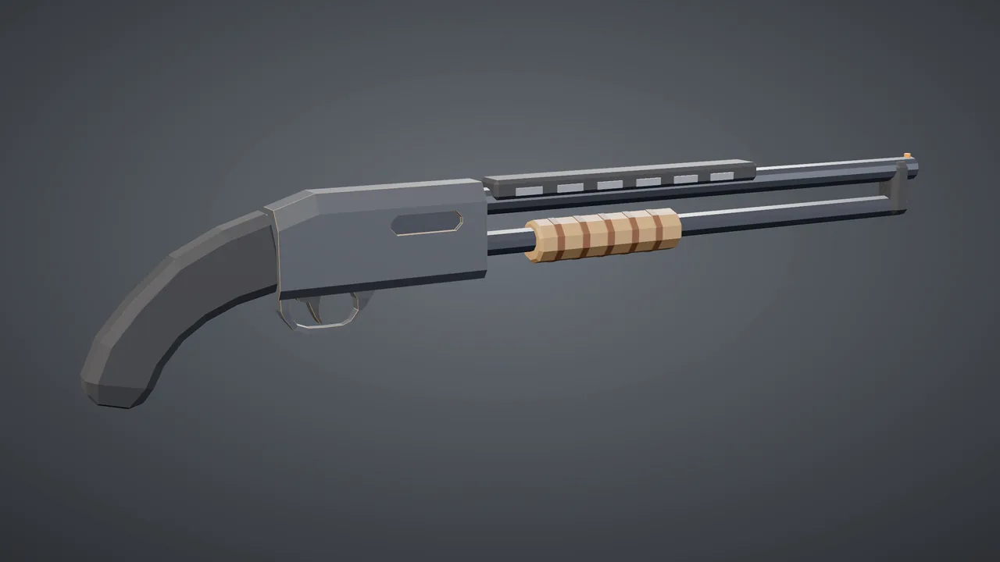

**Shotgun** `shotgun`. Nine pellets at short range. It loads a round at a time, so you can top it up between fights.

| Default | |
| --- | --- |
| Damage | 12 x 9 pellets (dart) |
| Fire rate | 75 rpm |
| Fire modes | semi |
| Magazine | 8 + 32 reserve |
| Reload | 0.42 s per round |
| Spread | 4.2 deg standing, 0.5 moving, 0.5 crouched, 4 airborne |
| Recoil | 2.4 deg up, 0.15 deg side |
| Range | 26 m |
| Draw time | 0.38 s |

### Drum Shotgun

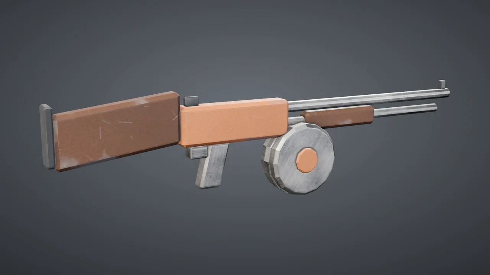

**Shotgun** `drum_shotgun`. An automatic shotgun with a twenty-round drum. It gives up range and reload speed to keep firing.

| Default | |
| --- | --- |
| Damage | 8 x 7 pellets (dart) |
| Fire rate | 192 rpm |
| Fire modes | auto, semi |
| Magazine | 20 + 40 reserve |
| Reload | 4 s |
| Spread | 5.4 deg standing, 1.2 moving, 0.5 crouched, 4 airborne |
| Recoil | 1.1 deg up, 0.15 deg side |
| Range | 20 m |
| Draw time | 0.42 s |
| Weight | 4 kg |

### Marksman Rifle

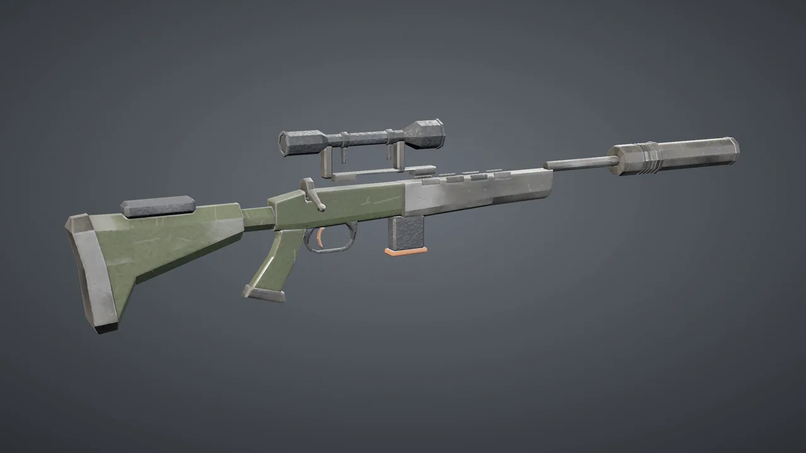

**Marksman rifle** `marksman`. A scoped semi-automatic for picking targets off at range. Pinpoint when still, poor on the move.

| Default | |
| --- | --- |
| Damage | 58 (dart) |
| Fire rate | 183 rpm |
| Fire modes | semi |
| Magazine | 10 + 40 reserve |
| Reload | 2.59 s |
| Spread | 0.08 deg standing, 4.5 moving, 0.3 crouched, 8 airborne |
| Bloom | +1.4 deg per shot, up to 6 |
| Recoil | 2 deg up, 0.15 deg side |
| Range | 400 m (falloff 30-70 m to 60 %) |
| Draw time | 0.45 s |
| Weight | 5 kg |

### Sniper Rifle

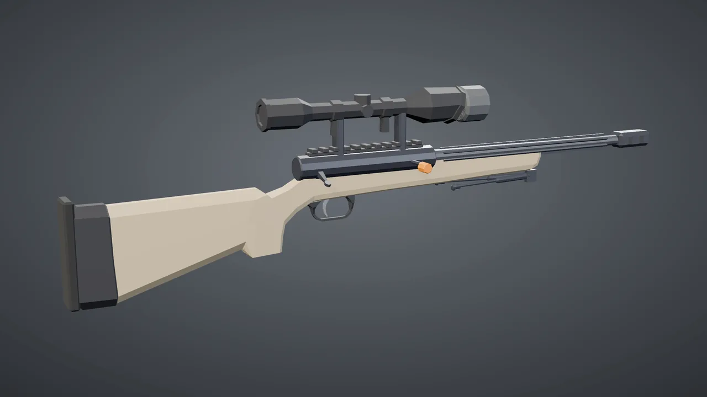

**Sniper rifle** `sniper`. The longest reach and the biggest hit with a dart. One shot drops most targets, but only if you stand still to take it.

| Default | |
| --- | --- |
| Damage | 118 (dart) |
| Fire rate | 45 rpm |
| Fire modes | semi |
| Magazine | 5 + 25 reserve |
| Reload | 3.2 s |
| Spread | 0 deg standing, 8 moving, 14 airborne |
| Recoil | 4 deg up, 0.15 deg side |
| Range | 1000 m (falloff 30-70 m to 60 %) |
| Draw time | 0.7 s |
| Weight | 6 kg |

### Minigun

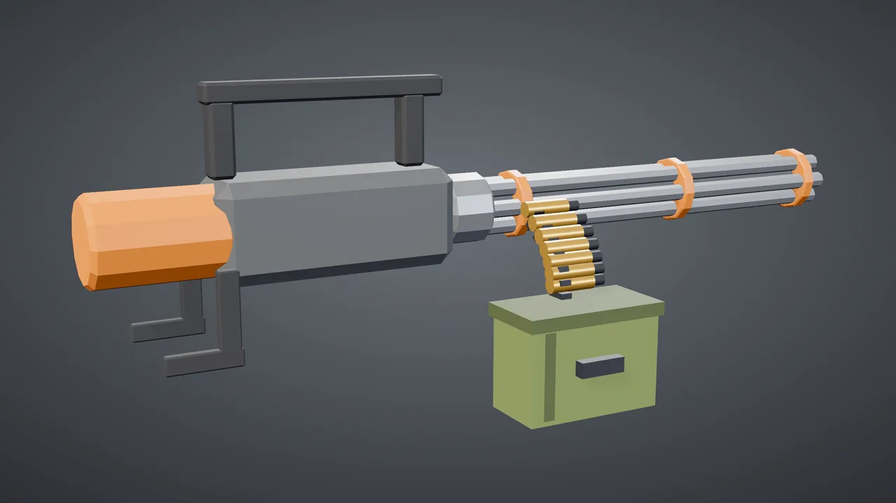

**Heavy** `minigun`. No magazine and the highest fire rate in the pack. Slow to bring up and heavy to carry, it holds a corridor on its own.

| Default | |
| --- | --- |
| Damage | 11 (dart) |
| Fire rate | 1280 rpm |
| Fire modes | auto, semi |
| Spread | 2.4 deg standing, 4.5 moving, 0.5 crouched, 7 airborne |
| Bloom | +0.08 deg per shot, up to 2 |
| Recoil | 0.12 deg up, 0.1 deg side |
| Range | 110 m (falloff 30-70 m to 60 %) |
| Draw time | 1.09 s |
| Weight | 7.5 kg |

### Launcher

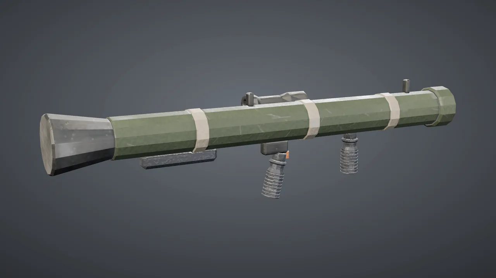

**Launcher** `launcher`. Rockets that splash. A direct hit is not needed; landing one near a group is.

| Default | |
| --- | --- |
| Damage | 32 (blast) |
| Splash | 88 within 4.5 m |
| Fire rate | 70 rpm |
| Fire modes | semi |
| Magazine | 4 + 12 reserve |
| Reload | 2.8 s |
| Recoil | 3 deg up, 0.15 deg side |
| Projectile speed | 44 m/s |
| Draw time | 0.5 s |
| Weight | 6 kg |

### Beamer

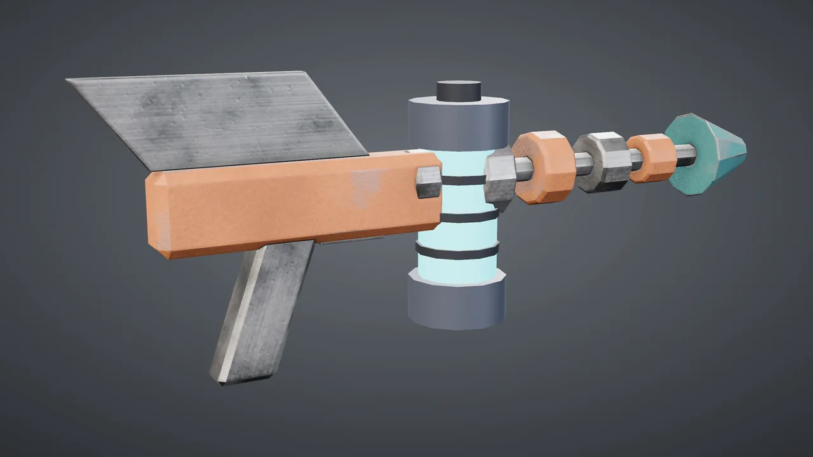

**Energy** `beamer`. A continuous beam that hurts more the longer you keep it on target. Short range, but nothing to reload.

| Default | |
| --- | --- |
| Damage | 9 (energy) |
| Fire rate | 960 rpm |
| Fire modes | hold |
| Range | 40 m |
| Draw time | 0.41 s |
| Weight | 6 kg |

### Charge Rifle

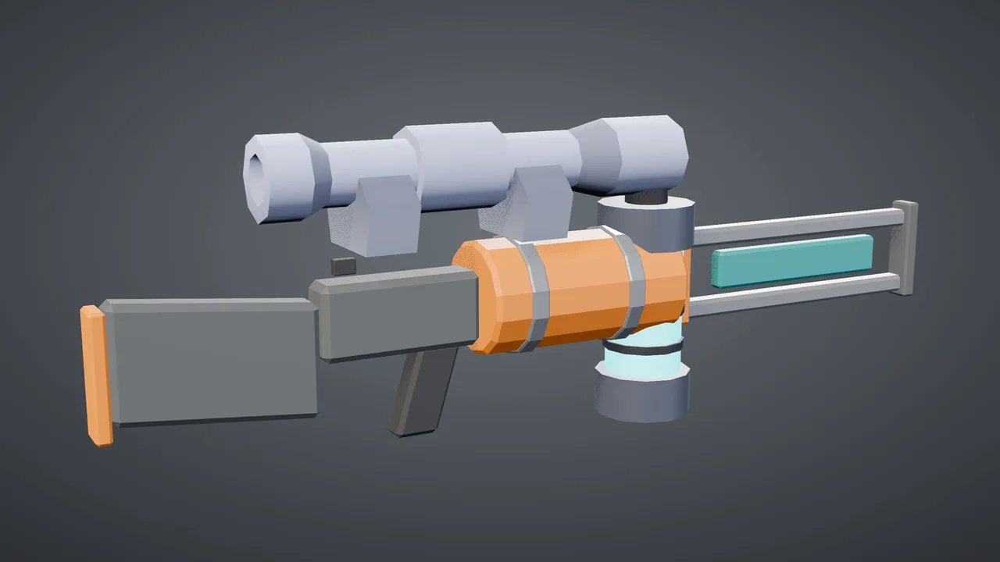

**Energy** `charge_rifle`. Hold to charge and release for a hit that crosses the map. A quick tap fires at a third of the damage.

| Default | |
| --- | --- |
| Damage | 105 (energy) |
| Uncharged damage | 33 % |
| Full charge | 1.09 s |
| Fire rate | 89 rpm |
| Fire modes | charge |
| Magazine | 4 + 24 reserve |
| Reload | 2.59 s |
| Spread | 0 deg standing, 3 moving, 0.5 crouched, 6 airborne |
| Recoil | 2.6 deg up, 0.15 deg side |
| Range | 500 m |
| Draw time | 0.5 s |
| Weight | 6 kg |

### Frag Grenade

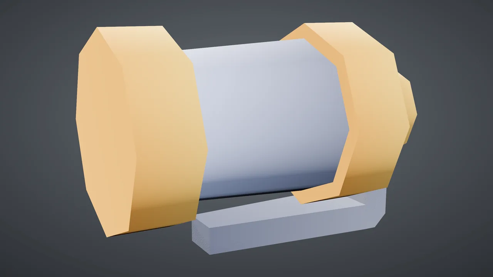

**Grenade** `frag`. A three-second fuse and the widest blast of the two grenades. Bounce it round a corner to flush people out.

| Default | |
| --- | --- |
| Splash | 115 within 5.2 m |
| Throw rate | 60 rpm |
| Fire modes | charge |
| Carried | 2 (max 4) |
| Recoil | 0.4 deg up, 0.15 deg side |
| Projectile speed | 19 m/s |
| Fuse | 3 s |
| Draw time | 0.34 s |
| Weight | 0.4 kg |

### Sticky Charge

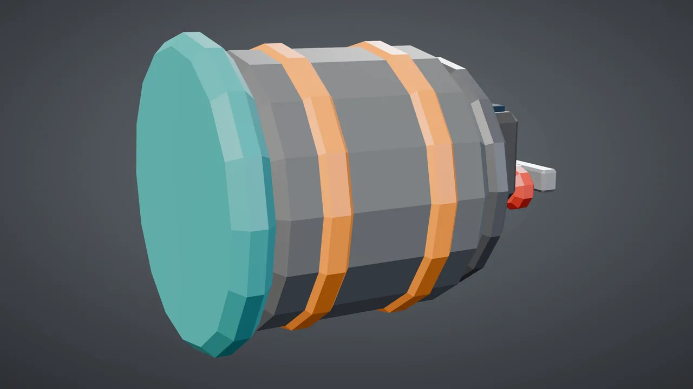

**Grenade** `sticky`. Sticks to whatever it hits and goes off a little sooner than the frag, with a smaller, harder blast.

| Default | |
| --- | --- |
| Splash | 135 within 4 m |
| Throw rate | 60 rpm |
| Fire modes | charge |
| Carried | 2 (max 4) |
| Recoil | 0.4 deg up, 0.15 deg side |
| Projectile speed | 22 m/s |
| Fuse | 2.2 s |
| Draw time | 0.34 s |
| Weight | 0.4 kg |
<!-- /gen_readme:weapons -->

## Credits

The twelve real-world guns are rebuilt by `blender -b --python art-src/guns/build.py` (one recipe per gun in `guns.py`). Parts are cut, reshaped and joined with modelled handguards, barrels, sights and magazines, so no gun is any one source model. Which parts each gun takes is in `assets/low-poly-guns/LICENSE.txt`. Each kit's licence is next to its files in `assets/`.

| Asset | Author / source | Licence |
| --- | --- | --- |
| Twelve real-world guns (parts) | [Quaternius](https://quaternius.com), [Ultimate Low Poly Guns Pack](https://opengameart.org/content/low-poly-guns-pack) | CC0 1.0 |
| Toy and sci-fi weapons, two gun parts | [Kenney](https://kenney.nl/assets/blaster-kit), Blaster Kit | CC0 1.0 |
| Melee weapons, ammunition | [Kenney](https://kenney.nl), Weapon Pack and Survival Kit | CC0 1.0 |
| Blocky arms (third style) | [Kenney](https://kenney.nl), Blocky Characters | CC0 1.0 |
| First-person arm (`assets/arms/arms-rigged.glb`) | para, [fps arms (rigged only)](https://opengameart.org/content/fps-arms-rigged-only), reshaped by `art-src/arms/build_arms.py`; changes in `assets/arms/LICENSE-fps-arms-para.txt` | CC0 1.0 |
| Fire-mode selector clicks | TMC: synthesised in `zee_weapon_sound.gd` | MIT |
| Code | TMC | MIT, see [LICENSE](LICENSE) |
